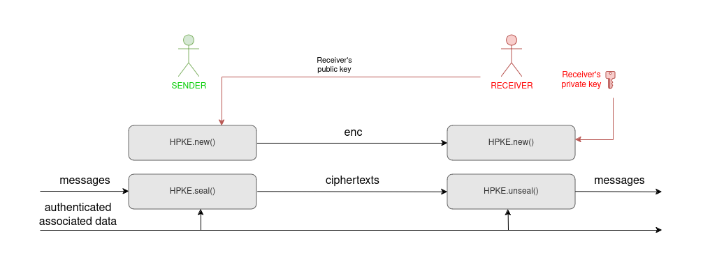
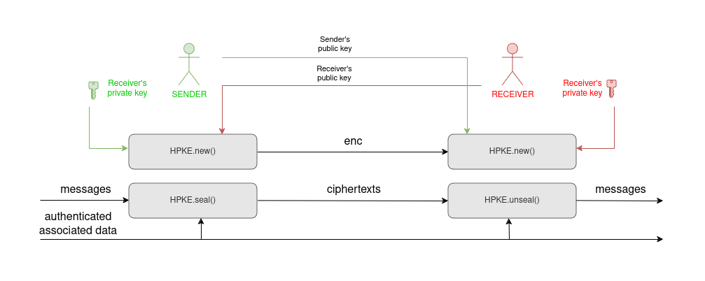
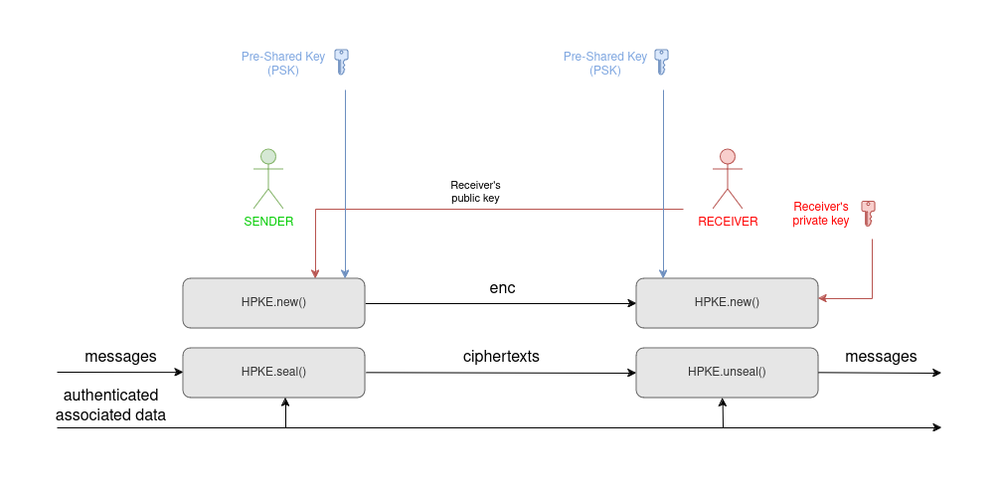

.. _hpke:

Hybrid Public Key Encryption (HPKE)
=====================================

.. module:: Crypto.Protocol.HPKE

HPKE (`RFC 9180 <https://www.rfc-editor.org/rfc/rfc9180.html>`_)
is a non-interactive protocol that enables secure communication
using a combination of public key cryptography
(a Key Encapsulation Mechanism, KEM)
and symmetric encryption (Authenticated Encryption with Associated Data, AEAD).

It allows a sender that knows the public key of the intended recipient
to encrypt one or more messages, ensuring confidentiality and integrity,
without any interaction with the recipient.

There are no significant limits on the size of a single message or
on the number of messages in the sequence.
Along with each encrypted message (**ciphertext**),
the sender can also deliver a piece of non-sensitive data (e.g., a header),
which is authenticated together with the matching message
(**additional authenticated data, AAD**).

Before or together with the first message, the sender must deliver
the encapsulated session secret (**enc**) to the receiver.

In the basic scheme above, the receiver gets no proof
of the sender's identity.
Variants of the protocol exist to enable the receiver to ascertain
the origin of the message.

**First variant: Auth mode**. The sender can contribute its own private key to the encryption.
The receiver must have the matching public key:

**Second variant: PSK mode**. The sender and the receiver can agree on a secret key
(a pre-shared key, PSK, of at least 32 random bytes) and use it for both encryption and decryption.

Finally, the two authentication modes can also be combined (*AuthPSK* mode).

.. note::

   The PSK is only used to authenticate the messages; it is not a replacement
   for the asymmetric key that the receiver must provide to the sender.

.. note::

   Future versions of HPKE will drop support for Auth and AuthPSK modes.

Examples
~~~~~~~~~

This is how the sender can encrypt two messages::

        from Crypto.Protocol import HPKE

        # Let's assume that the recipient has delivered its public key,
        # which is already loaded in a variable called their_pub_key
        #
        # For the sake of clarity, it could be simulated with:
        #
        #    from Crypto.PublicKey import ECC
        #    their_key = ECC.generate(curve='p256')
        #    their_pub_key = their_key.public_key()

        encryptor = HPKE.new(receiver_key=their_pub_key,
                             aead_id=HPKE.AEAD.AES128_GCM)

        ct_1 = encryptor.seal(b'Message 1')
        ct_2 = encryptor.seal(b'Message 2')

        # The sender will deliver:
        # - encryptor.enc as enc
        # - ct_1
        # - ct_2

And this is how the receiver can decrypt them::

        from Crypto.Protocol import HPKE

        # Let's assume that the recipient has its own private key,
        # which is already loaded in a variable called my_key
        #
        # To continue the simulation, assign:
        #
        #   my_key = their_key

        decryptor = HPKE.new(receiver_key=my_key,
                             aead_id=HPKE.AEAD.AES128_GCM,
                             enc=enc)

        # Any of the calls to unseal() can raise ValueError
        # if it detects a key mismatch, a modified message, or messages out of order
        pt1 = decryptor.unseal(ct_1)
        pt2 = decryptor.unseal(ct_2)

HPKE can also derive shared secret material without encrypting messages::

        from Crypto.Protocol import HPKE

        exporter = HPKE.new(receiver_key=their_pub_key,
                            aead_id=HPKE.AEAD.EXPORT_ONLY)

        secret = exporter.export(b'example context', 32)

        # The sender will deliver exporter.enc as enc.
        # The receiver will create the same context with its private key
        # and call export() with the same context and length.

Post-quantum HPKE
~~~~~~~~~~~~~~~~~

HPKE based on ECC keys (DHKEM) is not secure against quantum computers.
An extension of HPKE, still at the draft stage (`draft-ietf-hpke-pq`_),
defines how to use post-quantum cryptographic keys:

* an :doc:`ML-KEM key <../public_key/mlkem>`, or
* a :doc:`hybrid key <../public_key/hybrid>` of the hybrid KEM X-Wing,
  which combines ML-KEM and X25519 and remains secure as long as at least one of them is secure.

The KEM (and with it the KDF) is selected by the type of the receiver key:

.. csv-table::
   :header: Receiver key, KEM, KDF, Size of enc
   :widths: 40, 20, 20, 20

   "ECC, ``NIST P-256``", "DHKEM(P-256)", "HKDF-SHA256", "65 bytes"
   "ECC, ``NIST P-384``", "DHKEM(P-384)", "HKDF-SHA384", "97 bytes"
   "ECC, ``NIST P-521``", "DHKEM(P-521)", "HKDF-SHA512", "133 bytes"
   "ECC, ``Curve25519``", "DHKEM(X25519)", "HKDF-SHA256", "32 bytes"
   "ECC, ``Curve448``", "DHKEM(X448)", "HKDF-SHA512", "56 bytes"
   "ML-KEM, ``MLKEM.ML_KEM_512``", "ML-KEM-512", "HKDF-SHA256", "768 bytes"
   "ML-KEM, ``MLKEM.ML_KEM_768``", "ML-KEM-768", "HKDF-SHA256", "1088 bytes"
   "ML-KEM, ``MLKEM.ML_KEM_1024``", "ML-KEM-1024", "HKDF-SHA384", "1568 bytes"
   "Hybrid, ``Hybrid.MLKEM768_X25519``", "MLKEM768-X25519", "HKDF-SHA256", "1120 bytes"

The hybrid KEMs MLKEM768-P256 and MLKEM1024-P384 of `draft-ietf-hpke-pq`_ are not supported yet.

With ML-KEM and X-Wing, only the Base and PSK modes are available:
the *Auth* and *AuthPSK* modes are not supported (i.e., ``sender_key`` must not be specified).
The rest of the API is the same::

        from Crypto.Protocol import HPKE
        from Crypto.PublicKey import Hybrid

        # The receiver
        my_key = Hybrid.generate(param_set=Hybrid.MLKEM768_X25519)
        their_pub_key = my_key.public_key()

        # The sender
        encryptor = HPKE.new(receiver_key=their_pub_key,
                             aead_id=HPKE.AEAD.CHACHA20_POLY1305)
        ct = encryptor.seal(b'Message 1')

        # The receiver again
        decryptor = HPKE.new(receiver_key=my_key,
                             aead_id=HPKE.AEAD.CHACHA20_POLY1305,
                             enc=encryptor.enc)
        pt = decryptor.unseal(ct)

.. _`draft-ietf-hpke-pq`: https://datatracker.ietf.org/doc/draft-ietf-hpke-pq/

Specification
~~~~~~~~~~~~~

.. autoclass:: Crypto.Protocol.HPKE.AEAD
   :members:
   :undoc-members:

.. autofunction:: Crypto.Protocol.HPKE.new

.. autoclass:: Crypto.Protocol.HPKE.HPKE_Cipher
   :members:
   :undoc-members:
